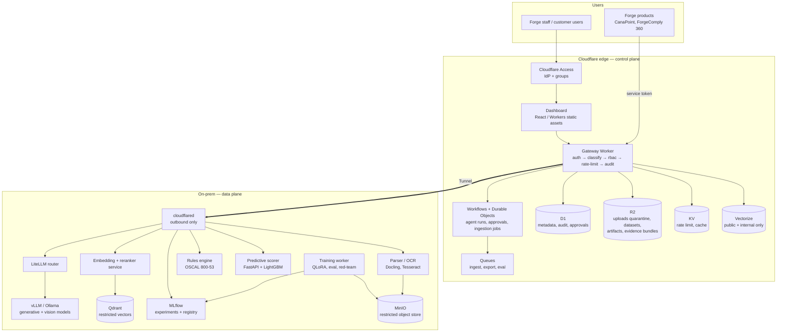
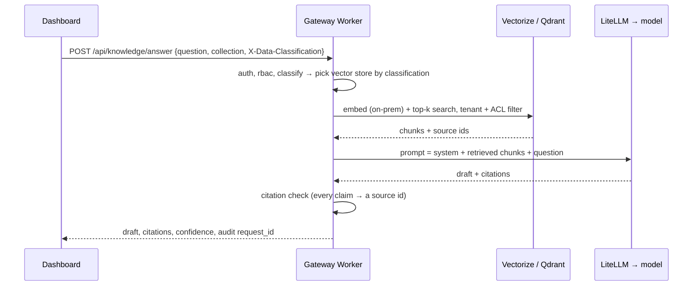
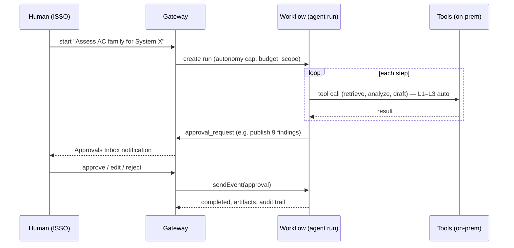

# 01 — Architecture

> Status: **PROPOSED** (Gate G0)

## 1. Topology

Two planes, joined only by an outbound-only Cloudflare Tunnel.

- **Control plane (Cloudflare)** — identity, policy, orchestration state,
  approvals, metadata, audit, UI. Holds *no restricted content* (CUI / PHI /
  classified) at rest.
- **Data plane (on-prem GPU host / customer enclave)** — models, embeddings,
  vector index for restricted data, training, scoring, document parsing.

## 2. Components

### 2.1 Control plane (Cloudflare)

| Component | New / existing | Responsibility |
|---|---|---|
| Gateway Worker (`worker/`) | Existing, extended | Single external surface. Adds routes `/api/knowledge/*`, `/api/datasets/*`, `/api/agents/*`, `/api/approvals/*`, `/api/predict/*`, `/api/training/*`, `/api/analyze/*`. Every route passes through the existing `authenticate` → `hasPermission` → rate limit → `logAuditEvent` pipeline in `worker/src/index.ts`. |
| Cloudflare Workflows | New | Durable, resumable multi-step runs (agent runs, ingestion, training orchestration). Native `step.waitForEvent()` is how a run **pauses for human approval**. |
| Durable Objects | New | Per-run coordination + live status stream (WebSocket) to the dashboard; per-tenant serialization of approvals. |
| Queues | New | Fan-out for ingestion chunks, eval batches, large ConMon exports (existing TODO). |
| D1 | Existing, extended | Metadata only. New tables in [`03`](03-agents-and-governance.md#6-proposed-d1-schema-draft). |
| R2 | Existing (`MODEL_BUCKET`), + new `DATA_BUCKET` | `quarantine/`, `datasets/`, `evidence/` prefixes for **public / internal** data; restricted data is never written here (see §4). |
| Vectorize | New | Vector index for `public` and `internal` knowledge only. |
| KV | Existing (`INFERENCE_CACHE`) | Rate-limit counters, short-lived caches. Never caches restricted prompts or outputs. |
| Dashboard (`dashboard/`) | Existing, extended | New pages: Knowledge, Datasets, Agents, Approvals Inbox, Predictions, Training, Evaluations. |

### 2.2 Data plane (on-prem, `docker-compose.yml`)

| Service | New / existing | Responsibility |
|---|---|---|
| `cloudflared` | Existing | Outbound-only tunnel; one ingress hostname per service. |
| `litellm` | Existing | One OpenAI-compatible router for all chat, vision, and embedding models. |
| `ollama` | Existing | Dev / small-footprint serving. |
| `vllm` | New | Production serving (batching, higher throughput). See [ADR-0001](../adr/0001-model-serving-vllm-and-ollama.md). |
| `embedder` | New | Text embeddings + cross-encoder reranker (e.g. `bge-m3`, `bge-reranker`), exposed via LiteLLM `/v1/embeddings`. |
| `qdrant` | New | Vector store for `cui` / `phi` / `classified` (and all data in air-gap mode). See [ADR-0002](../adr/0002-vector-store-split.md). |
| `parser` | New | Docling + Tesseract OCR: PDF, DOCX, XLSX, images, OSCAL JSON/XML, scanner exports (Nessus, SCAP). |
| `rules` | New | Deterministic control checks against OSCAL catalogs/profiles. See [ADR-0004](../adr/0004-rules-engine-authority.md). |
| `scorer` | New | FastAPI predictive model server loading MLflow-registered models. See [ADR-0005](../adr/0005-predictive-stack.md). |
| `trainer` | New (GPU, on-demand profile) | QLoRA fine-tuning, eval harness, red-team runs. |
| `mlflow` | Existing | Experiments, metrics, model registry for predictive + fine-tuned models. |
| `minio` | New | S3-compatible store for restricted raw files, datasets, adapters. |
| `redis` | Existing (optional) | LiteLLM cache — disabled for restricted classifications. |

## 3. Key data flows

### 3.1 Grounded generation (RAG) — e.g. "Draft the AC-2 narrative"

Restricted (`cui`/`phi`/`classified`) search runs entirely on-prem: the gateway
calls a single tunnel endpoint (`/rag/answer`) and only receives the final
answer + source ids, never raw chunks persisted at the edge.

### 3.2 Data ingestion (Gate G1)

`upload → quarantine → scan + classify → G1 approval → parse → chunk → embed → index → available`

Detail in [`02-data-and-learning.md`](02-data-and-learning.md#2-how-you-give-it-data).

### 3.3 Agent run (Gate G4)

### 3.4 Learning loop (Gates G2, G3)

`approved dataset → G2 training approval → QLoRA run → eval + red-team → register version (dev) → staged → approved → G3 two-person → production`

## 4. Classification-driven routing

The existing `classification_policies.allowed_destinations` drives **where data
and vectors may live**. We add one destination value, `vectorize`, and keep
the rest:

| Classification | Raw files | Vectors | Inference | Edge caching |
|---|---|---|---|---|
| `public` | R2 | Vectorize | on-prem (cloud allowed by policy) | allowed |
| `internal` | R2 | Vectorize | on-prem | allowed, short TTL |
| `cui` | MinIO (on-prem) | Qdrant | on-prem only | **never** |
| `phi` | MinIO, tokenized | Qdrant | on-prem only, `X-PHI-Tokenized` | **never** |
| `classified` | MinIO (enclave) | Qdrant | on-prem only | **never** |

`enforceClassification(env, classification, destination)` in
`worker/src/middleware/classify.ts` is reused unchanged — callers just pass the
new destination (`'vectorize'`, `'r2'`, `'on-prem'`). `AllowedDestination` in
`worker/src/types.ts` gains `'vectorize'`.

## 5. Deployment modes

| Aspect | **Hybrid** (default) | **Air-gap** (per-tenant switch) |
|---|---|---|
| Control plane | Cloudflare Workers, D1, R2, KV, Vectorize, Workflows | Same Worker code run locally on `workerd` (see [ADR-0006](../adr/0006-air-gap-runtime.md)) |
| Identity | Cloudflare Access + IdP | Local OIDC (Keycloak) issuing the same JWT claims (`email`, `groups`) |
| Metadata DB | D1 | SQLite (D1 is SQLite — same migrations) |
| Objects | R2 + MinIO | MinIO only |
| Vectors | Vectorize + Qdrant | Qdrant only |
| Orchestration | Cloudflare Workflows | Local workflow adapter (same step interface), backed by SQLite |
| Updates | `git` + Workers Builds | Signed offline bundle (containers + models + migrations), verified on import |
| Network | Outbound-only tunnel | None — no route to the internet |

Code rule that makes the switch possible: **handlers depend on small
interfaces** (`ObjectStore`, `VectorStore`, `WorkflowRunner`, `IdentityVerifier`)
with a Cloudflare implementation and a local implementation. No handler calls
`env.DATA_BUCKET` or Vectorize directly.

## 6. Non-functional targets (pilot)

| Metric | Target |
|---|---|
| RAG answer p95 (8B model, top-8 chunks) | < 6 s |
| Evidence-review throughput | ≥ 500 artifacts/hour on one 48 GB GPU |
| Ingestion | ≥ 1,000 pages/hour |
| Availability (control plane) | 99.9% (Cloudflare SLA) |
| Availability (data plane) | 99.5% single host; HA is a later phase |
| Audit completeness | 100% of privileged actions + all gate decisions |
