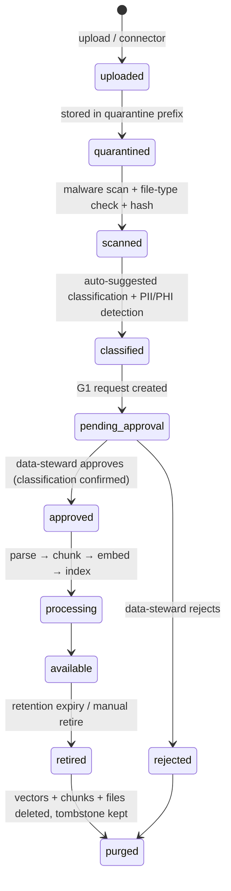
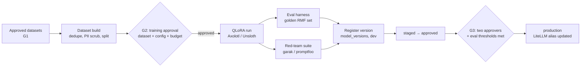

# 02 — Data and Learning

> Status: **PROPOSED** (Gate G0)

The platform "learns" in **three different ways**. They are easy to confuse,
so they are kept separate in both the UI and the code.

| Mechanism | What changes | Speed | Typical data | Human gate |
|---|---|---|---|---|
| **Knowledge (RAG)** | The index the model reads from. Model weights unchanged. | Minutes | Policies, SSPs, evidence, OSCAL catalogs, scan results | G1 |
| **Fine-tuning** | Model weights (LoRA adapter) — style, terminology, task format | Hours | Curated Q&A, approved narratives, assessor-edited drafts | G1 → G2 → G3 |
| **Predictive training** | A tabular ML model | Minutes–hours | Historical findings, POA&M history, scan trends, evidence ages | G1 → G2 → G3 |

**Default answer to "teach it something": add it to Knowledge.** Fine-tune only
when the base model consistently gets *format or reasoning style* wrong after
good retrieval.

## 1. Data sources (CanaPoint first)

| Source | Format | Used by |
|---|---|---|
| NIST SP 800-53 Rev 5 catalog, baselines, assessment procedures (800-53A) | OSCAL JSON | Rules, RAG, Generative |
| FedRAMP / CMMC / HIPAA profiles | OSCAL JSON, PDF | Rules, RAG |
| Customer SSP, policies, procedures | DOCX, PDF | RAG, Analytical |
| Evidence artifacts | PDF, PNG screenshots, CSV/JSON config exports | Analytical, Multimodal |
| Vulnerability scans | Nessus `.nessus`, SCAP/XCCDF, CSV | Analytical, Predictive |
| POA&M history | XLSX / OSCAL POA&M | Predictive, Generative |
| Prior assessment results (SAR) | DOCX / OSCAL AR | Fine-tuning, Predictive labels |
| Assessor edits to AI drafts | Captured automatically | Fine-tuning (preference data) |

## 2. How you give it data

From the dashboard **Knowledge → Add source** (or API `POST /api/knowledge/sources`):

Rules:

1. **Classification is declared by the uploader and confirmed by a human.** The
   detector can only *raise* a suggestion (e.g. "SSN-like pattern found → phi?"),
   never lower it.
2. **Files never pass through the gateway's JSON API** (it keeps its 1 MB
   request cap in `worker/src/index.ts`). Uploading is a three-step flow:
   `POST /api/knowledge/sources` (metadata only, < 1 MB) → the gateway checks
   auth, RBAC and classification and returns a **short-lived, single-object
   presigned upload URL** → the browser uploads directly → `POST
   /api/knowledge/sources/:id/complete` verifies size and SHA-256 and moves the
   source to `quarantined`.
   - `public` / `internal`: presigned **R2** PUT URL into the `quarantine/`
     prefix (multipart for large files).
   - `cui` / `phi` / `classified`: presigned **on-prem MinIO** URL on a
     dedicated tunnel hostname (`upload.<domain>`) protected by Cloudflare
     Access. Bytes go straight to MinIO and never touch R2 or the Worker.
   - Default per-file limit 500 MB (tenant-configurable); URLs expire in
     15 minutes and are bound to the declared size, content type and hash.
3. Every file has a SHA-256, uploader, source, classification, tenant, and
   retention date. Hash is re-checked before training use.
4. **Connectors** (later phase): scheduled pulls from SharePoint, Google Drive,
   GitHub, ServiceNow, Tenable, eMASS exports. Connector output enters the same
   quarantine pipeline — no bypass.
5. **Delete means delete.** Retire → purge removes the object, chunks, and
   vectors, and writes a tombstone + audit event. Fine-tuned adapters trained on
   a purged dataset are flagged for retraining review.

## 3. Knowledge / RAG design

| Decision | Choice |
|---|---|
| Parsing | Docling (layout-aware PDF/DOCX), Tesseract OCR for images, native parsers for OSCAL, Nessus, XCCDF |
| Chunking | Structure-aware: one chunk per OSCAL control/part; headings-based for documents (~500–800 tokens, 15% overlap) |
| Metadata on every chunk | `tenant_id`, `collection_id`, `source_id`, `classification`, `control_ids[]`, `system_id`, `page`, `valid_until` |
| Embeddings | `public` / `internal`: Workers AI `bge` embedding model → Vectorize (no on-prem service needed). Restricted: on-prem `bge-m3` via LiteLLM `/v1/embeddings` → Qdrant. A collection never mixes the two, since vectors from different models are not comparable. |
| Retrieval | Hybrid: vector + BM25 keyword (Qdrant sparse vectors) → cross-encoder rerank → top-k |
| Isolation | Mandatory filter `tenant_id = caller.tenant AND collection_id IN caller.allowed_collections`; enforced in the gateway, not the prompt |
| Citations | Every generated claim must map to a returned `source_id`; uncited claims are flagged in the UI |
| Freshness | Evidence chunks carry `valid_until`; expired evidence is retrievable but labeled "stale" |

Collections are the unit of access control (e.g. `nist-catalogs` shared by all
tenants; `acme-system-x-evidence` visible to one tenant + system).

## 4. Fine-tuning loop (on-prem GPU)

- **Base models:** open-weight, license-reviewed (Llama 3.1 8B today per
  `config/Modelfile.forge-compliance`). Required model classes for the pilot
  (reviewer, 2026-10-19): **70B-class LLMs** (e.g. Llama 3.x 70B, Qwen 72B),
  **vision / document models**, **security-specific models**, and **Forge
  fine-tuned models**. Each specific model is license-reviewed and recorded
  in the model registry before use; base model choice is an ADR per upgrade.
- **Training data sources:** approved narratives, assessor-edited drafts
  (original → edited pairs become preference data for DPO), curated Q&A.
- **Eval harness (blocks promotion):**
  - *Control-citation accuracy*: does it cite real 800-53 IDs? (target ≥ 98%)
  - *Grounding / faithfulness*: claims supported by retrieved sources (≥ 95%)
  - *Narrative quality*: rubric-scored by held-out assessors (≥ baseline)
  - *Refusal correctness*: refuses to make G5 determinations (100%)
  - *Regression*: no metric drops > 2 pts vs current production
- **Red-team:** prompt injection via evidence documents, data exfiltration
  attempts, jailbreaks, cross-tenant probing. Any critical finding blocks G3.
- **Outputs:** LoRA adapter + merged GGUF/safetensors, SHA-256, training config,
  dataset ids (lineage), eval report — stored in MinIO and referenced from
  `model_versions.provenance_uri` / `sha256_hash` (columns already exist).

## 5. Predictive training loop

| Model | Target | Features (examples) | Label source |
|---|---|---|---|
| Control-failure risk | P(control assessed other-than-satisfied next cycle) | control family, prior results, evidence age, open POA&Ms, scan criticals, change frequency | Prior SARs |
| Evidence expiry | Days until evidence is stale/insufficient | artifact type, collection cadence, last refresh | Evidence history |
| Assessment readiness | Readiness score per system (0–100) | % controls with current evidence, gap counts, POA&M aging | Assessment outcomes |
| POA&M slippage | P(milestone missed) | severity, owner load, age, dependency count | POA&M history |

- Stack: pandas feature build → LightGBM (with calibrated probabilities) →
  MLflow run + model registry → `scorer` service loads `production` alias.
- **Explainability is mandatory**: every prediction returns top SHAP feature
  contributions so a human can see *why*.
- Predictions are **advisory**. They prioritize work; they never change a
  compliance status.
- Drift monitoring: weekly PSI on features + calibration check; alert when
  thresholds exceed limits, which opens a retraining G2 request.
- Cold start: until a tenant has enough history (~200 labeled control
  assessments), use a Forge-wide model trained on anonymized, approved data,
  plus rules-based heuristics.

## 6. Retention (decided: best-practice defaults)

Defaults are set by the strictest regime a Forge tenant commonly falls under,
so a single default works for FedRAMP/FISMA, CMMC and HIPAA customers. Tenants
may **lengthen** any value; shortening below a *minimum* requires an `admin`
change that is itself audited.

| Item | Default retention | Driver | Tenant can change |
|---|---|---|---|
| Audit events, gate decisions, reserved (G5) decisions, role assignments | **7 years** | Covers HIPAA documentation (6 yrs, 45 CFR 164.316), CMMC artifact retention (6 yrs, 32 CFR 170), NIST AU-11 | Lengthen only (minimum) |
| Evidence files supporting an assessment | **6 years** after the assessment they support | CMMC / HIPAA; lets a finding be defended later | Yes |
| Other uploaded raw files (policies, reference docs) | Engagement end + 1 year | Data minimization | Yes |
| Chunks / vectors | Follow their source; purged within 30 days of source purge | Derived data must not outlive its source | Follows source |
| Prompts and outputs | **Not stored** for `cui` / `phi` / `classified` (existing README assumption #7). `public` / `internal`: 90 days, only if the tenant opts in | Minimization; LLM02 | Yes |
| AI drafts that became records (approved narratives, findings, POA&M items) | Same as the record (6 years) | They are part of the assessment record | Follows record |
| Agent run metadata and step summaries | 6 years | AI accountability record (§7 of `03`) | Yes |
| Predictions | 2 years; any prediction cited in a decision is kept with that decision | Drift analysis + accountability | Yes |
| Training datasets, adapters, eval and red-team reports | Life of the model version + 3 years | Provenance and reproducibility (SR-4) | Yes |
| Operational logs / telemetry | 12 months hot + 18 months archive | OMB M-21-31 log-management guidance | Yes |
| Backups | 35 days point-in-time; monthly snapshots kept 12 months | Recovery; deletes propagate within one backup cycle | Yes |

**Overrides:** a legal hold set by an `admin` suspends purge for the affected
items until released (both actions audited). Purges always leave a tombstone
(id, hash, who, when, why) for the audit trail.
