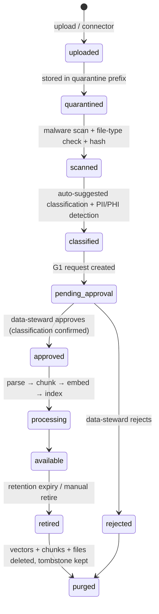
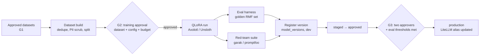

# 02 — Data and Learning

> Status: **PROPOSED** (Gate G0)

The platform "learns" in **three different ways**. They are easy to confuse,
so they are kept separate in both the UI and the code.

| Mechanism | What changes | Speed | Typical data | Human gate |
|---|---|---|---|---|
| **Knowledge (RAG)** | The index the model reads from. Model weights unchanged. | Minutes | Policies, SSPs, evidence, OSCAL catalogs, scan results | G1 |
| **Fine-tuning** | Model weights (LoRA adapter) — style, terminology, task format | Hours | Curated Q&A, approved narratives, assessor-edited drafts | G1 → G2 → G3 |
| **Predictive training** | A tabular ML model | Minutes–hours | Historical findings, POA&M history, scan trends, evidence ages | G1 → G2 → G3 |

**Default answer to "teach it something": add it to Knowledge.** Fine-tune only
when the base model consistently gets *format or reasoning style* wrong after
good retrieval.

## 1. Data sources (CanaPoint first)

| Source | Format | Used by |
|---|---|---|
| NIST SP 800-53 Rev 5 catalog, baselines, assessment procedures (800-53A) | OSCAL JSON | Rules, RAG, Generative |
| FedRAMP / CMMC / HIPAA profiles | OSCAL JSON, PDF | Rules, RAG |
| Customer SSP, policies, procedures | DOCX, PDF | RAG, Analytical |
| Evidence artifacts | PDF, PNG screenshots, CSV/JSON config exports | Analytical, Multimodal |
| Vulnerability scans | Nessus `.nessus`, SCAP/XCCDF, CSV | Analytical, Predictive |
| POA&M history | XLSX / OSCAL POA&M | Predictive, Generative |
| Prior assessment results (SAR) | DOCX / OSCAL AR | Fine-tuning, Predictive labels |
| Assessor edits to AI drafts | Captured automatically | Fine-tuning (preference data) |

## 2. How you give it data

From the dashboard **Knowledge → Add source** (or API `POST /api/knowledge/sources`):

Rules:

1. **Classification is declared by the uploader and confirmed by a human.** The
   detector can only *raise* a suggestion (e.g. "SSN-like pattern found → phi?"),
   never lower it.
2. Restricted uploads go **directly to on-prem MinIO** through the tunnel; the
   gateway streams them and never writes them to R2.
3. Every file has a SHA-256, uploader, source, classification, tenant, and
   retention date. Hash is re-checked before training use.
4. **Connectors** (later phase): scheduled pulls from SharePoint, Google Drive,
   GitHub, ServiceNow, Tenable, eMASS exports. Connector output enters the same
   quarantine pipeline — no bypass.
5. **Delete means delete.** Retire → purge removes the object, chunks, and
   vectors, and writes a tombstone + audit event. Fine-tuned adapters trained on
   a purged dataset are flagged for retraining review.

## 3. Knowledge / RAG design

| Decision | Choice |
|---|---|
| Parsing | Docling (layout-aware PDF/DOCX), Tesseract OCR for images, native parsers for OSCAL, Nessus, XCCDF |
| Chunking | Structure-aware: one chunk per OSCAL control/part; headings-based for documents (~500–800 tokens, 15% overlap) |
| Metadata on every chunk | `tenant_id`, `collection_id`, `source_id`, `classification`, `control_ids[]`, `system_id`, `page`, `valid_until` |
| Embeddings | On-prem `bge-m3` (multilingual, 8k context) via LiteLLM `/v1/embeddings` |
| Retrieval | Hybrid: vector + BM25 keyword (Qdrant sparse vectors) → cross-encoder rerank → top-k |
| Isolation | Mandatory filter `tenant_id = caller.tenant AND collection_id IN caller.allowed_collections`; enforced in the gateway, not the prompt |
| Citations | Every generated claim must map to a returned `source_id`; uncited claims are flagged in the UI |
| Freshness | Evidence chunks carry `valid_until`; expired evidence is retrievable but labeled "stale" |

Collections are the unit of access control (e.g. `nist-catalogs` shared by all
tenants; `acme-system-x-evidence` visible to one tenant + system).

## 4. Fine-tuning loop (on-prem GPU)

- **Base models:** open-weight, license-reviewed (Llama 3.1 8B today per
  `config/Modelfile.forge-compliance`; candidate upgrades: Llama 3.x 70B,
  Qwen 2.5 32B, Mistral Small). Base model choice is an ADR per upgrade.
- **Training data sources:** approved narratives, assessor-edited drafts
  (original → edited pairs become preference data for DPO), curated Q&A.
- **Eval harness (blocks promotion):**
  - *Control-citation accuracy*: does it cite real 800-53 IDs? (target ≥ 98%)
  - *Grounding / faithfulness*: claims supported by retrieved sources (≥ 95%)
  - *Narrative quality*: rubric-scored by held-out assessors (≥ baseline)
  - *Refusal correctness*: refuses to make G5 determinations (100%)
  - *Regression*: no metric drops > 2 pts vs current production
- **Red-team:** prompt injection via evidence documents, data exfiltration
  attempts, jailbreaks, cross-tenant probing. Any critical finding blocks G3.
- **Outputs:** LoRA adapter + merged GGUF/safetensors, SHA-256, training config,
  dataset ids (lineage), eval report — stored in MinIO and referenced from
  `model_versions.provenance_uri` / `sha256_hash` (columns already exist).

## 5. Predictive training loop

| Model | Target | Features (examples) | Label source |
|---|---|---|---|
| Control-failure risk | P(control assessed other-than-satisfied next cycle) | control family, prior results, evidence age, open POA&Ms, scan criticals, change frequency | Prior SARs |
| Evidence expiry | Days until evidence is stale/insufficient | artifact type, collection cadence, last refresh | Evidence history |
| Assessment readiness | Readiness score per system (0–100) | % controls with current evidence, gap counts, POA&M aging | Assessment outcomes |
| POA&M slippage | P(milestone missed) | severity, owner load, age, dependency count | POA&M history |

- Stack: pandas feature build → LightGBM (with calibrated probabilities) →
  MLflow run + model registry → `scorer` service loads `production` alias.
- **Explainability is mandatory**: every prediction returns top SHAP feature
  contributions so a human can see *why*.
- Predictions are **advisory**. They prioritize work; they never change a
  compliance status.
- Drift monitoring: weekly PSI on features + calibration check; alert when
  thresholds exceed limits, which opens a retraining G2 request.
- Cold start: until a tenant has enough history (~200 labeled control
  assessments), use a Forge-wide model trained on anonymized, approved data,
  plus rules-based heuristics.

## 6. Retention

| Item | Default retention | Configurable per tenant |
|---|---|---|
| Uploaded raw files | Engagement length + 1 year | Yes |
| Chunks / vectors | Same as source | Follows source |
| Prompts and outputs | **Not stored** for restricted classes (existing assumption #7); stored 90 days for public/internal when the tenant opts in | Yes |
| Agent run transcripts | 1 year (metadata); content follows classification rule above | Yes |
| Audit events | 7 years | No (minimum) |
| Training datasets / adapters | Life of model version + 1 year | Yes |
