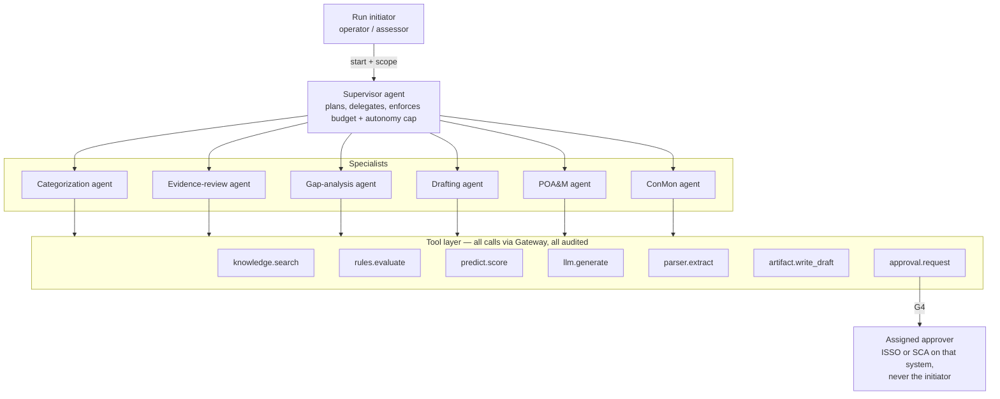

# 03 — Agents and Governance

> Status: **PROPOSED** (Gate G0)

## 1. Agent architecture

A **supervised multi-agent** design: one Supervisor plans and delegates;
specialist agents each have a narrow toolset. The **rules engine** is a tool,
not an agent — it is deterministic and is the authority on compliance facts.



## 2. Agent catalog (CanaPoint RMF)

| Agent | RMF step | Goal | Tools | Max autonomy | Needs approval for |
|---|---|---|---|---|---|
| Categorization | Categorize | Propose FIPS 199 impact levels from system description + data types | `knowledge.search`, `llm.generate`, `artifact.write_draft` | L2 | Any categorization becoming "proposed" (ISSO), final is G5 (AO) |
| Evidence-review | Assess | For each control, score whether linked evidence supports the requirement | `parser.extract`, `knowledge.search`, `rules.evaluate`, `llm.generate` | L3 | Publishing findings to the assessment record |
| Gap-analysis | Select / Implement | Compare implemented controls to baseline/overlay; list gaps with rationale | `rules.evaluate`, `knowledge.search`, `predict.score` | L3 | Publishing gap report |
| Drafting | Implement / Assess | Draft SSP narratives, SAR findings, executive summaries with citations | `knowledge.search`, `llm.generate`, `artifact.write_draft` | L2 | Every draft is reviewed before it leaves "draft" |
| POA&M | Authorize / Monitor | Draft POA&M items from findings; propose milestones; predict slippage | `predict.score`, `llm.generate`, `artifact.write_draft` | L4 | Creating/modifying POA&M records; **closing is G5** |
| ConMon | Monitor | Watch scans + evidence expiry; open draft actions; monthly ConMon summary | `predict.score`, `rules.evaluate`, `knowledge.search`, `approval.request` | L4 | Any notification sent outside Forge; any record change |
| Supervisor | All | Decompose goal, assign specialists, merge results, stop on budget/time | delegates only | = run cap | Plan approval when run cost estimate > threshold |

### Tool permission model

Each tool declares a **risk tier**; the run's autonomy cap decides what pauses.

| Tier | Examples | L1 | L2 | L3 | L4 |
|---|---|---|---|---|---|
| T0 read | `knowledge.search`, `rules.evaluate`, `predict.score`, `parser.extract` | auto | auto | auto | auto |
| T1 generate | `llm.generate` | auto | auto | auto | auto |
| T2 draft write | `artifact.write_draft` (draft space only) | ✗ | approve | auto | auto |
| T3 record write | update POA&M, attach finding to assessment | ✗ | ✗ | approve | approve* |
| T4 external | email/ticket/webhook outside platform | ✗ | ✗ | approve | approve |
| T5 reserved | conclusions, risk acceptance, ATO, close POA&M | **never** | **never** | **never** | **never** |

\* L4 may auto-execute T3 only for actions on an admin-maintained allowlist
(e.g. "set POA&M milestone date within ±14 days of proposal").

T5 actions **are not implemented as tools at all** — an agent physically
cannot call them. They exist only as human UI actions.

## 3. Gates G0–G5

| Gate | Trigger | Approver role | Evidence recorded | Blocks |
|---|---|---|---|---|
| **G0** Design | Any PR | Forge engineering lead | GitHub review + merge | Merge |
| **G1** Data | New source/dataset reaches `pending_approval` | `data-steward` (public/internal) or `data-steward-restricted` (cui/phi/classified) | classification confirmed, scan result, hash | Ingestion / training use |
| **G2** Training | `training_jobs` created | `approver` | dataset ids, config hash, GPU-hour budget | Job start |
| **G3** Promotion | Version → `production` | two distinct `approver`s | eval + red-team report ids, both identities | Existing `promoteModel` in `worker/src/handlers/models.ts` + new eval precondition |
| **G4** Agent action | Tool call above auto tier | a person **other than the run initiator** who holds the required role and an active assignment on the run's system (§5.2) | proposed action, diff, agent rationale, sources (restricted payloads by reference only, §6.1) | Workflow `waitForEvent` |
| **G5** Reserved | Human-only UI action | the person **assigned** to that system as `rmf-ao`, `rmf-sca` or `rmf-isso` (see §5.2) | signer identity, role assignment id, statement, linked AI artifacts | n/a — never automated |

Every gate decision writes `audit_events` with event types:

```
data.source.approval_requested   data.source.approved   data.source.rejected
training.job.approval_requested  training.job.approved  training.job.rejected
model.promotion.eval_checked     (plus existing model.promotion.approval_recorded, model.promoted)
agent.run.started  agent.step.completed  agent.action.approval_requested
agent.action.approved  agent.action.rejected  agent.action.edited
agent.run.halted   agent.run.completed
decision.reserved.signed
```

These flow into the existing `/api/audit/export` bundle per `conmon_period`.

### Approval rules

- **Separation of duties**: the person who started a run, uploaded a dataset,
  or launched a training job cannot approve their own G1/G2/G4 request.
  Enforced in the service layer: `decided_by` must differ from
  `requested_by` and, for G4, from `agent_runs.started_by`.
- **Approver routing (G4)**: every G4 request names a `required_role` and
  `system_id`; it is routed to the people holding an active assignment for
  that role on that system, excluding the initiator. **Pre-flight check:** a
  run cannot start unless at least one eligible approver other than the
  initiator exists for every tier it may need to pause on; otherwise the
  start is refused with a clear message instead of stranding the run.
- **Timeouts**: unanswered G4 requests expire (default 72 h) → run halts safely;
  nothing is auto-approved on timeout.
- **Edit-then-approve**: approvers can modify a proposed draft; the original vs
  edited pair is stored (it becomes fine-tuning preference data, after G1).
- **Kill switch**: `admin` can halt (a) one run, (b) all runs for a tenant,
  (c) all agents platform-wide. Implemented as a `system_config` flag checked
  before every tool call. Halting is itself audited at `critical` severity.
- **Budgets**: each run has max steps, max tokens, max wall-clock, max GPU
  seconds. Exceeding any → pause + G4 request for an extension.

## 4. Approvals Inbox (dashboard UX)

One page, `Approvals`, filtered to requests the user can act on:

```
┌ Approvals Inbox ──────────────────────────────────────────────────────┐
│ [G4] Evidence-review · System X · "Publish 9 findings"   2h ago  HIGH │
│      Agent rationale ▸   Sources (14) ▸   Diff ▸                     │
│      [Approve] [Edit & approve] [Reject + reason]                     │
│ [G1] Dataset "FY26 SAR corpus" · cui · 412 files         1d ago       │
│ [G2] Training job forge-compliance-v2 · 18 GPU-h          1d ago       │
└───────────────────────────────────────────────────────────────────────┘
```

Each item shows: what will happen, why the agent proposes it, the evidence and
sources, the confidence and rules-engine verdict, and what is irreversible.

## 5. Roles (extends `worker/src/middleware/rbac.ts`)

### 5.1 Platform roles and IdP groups

IdP group names are **tenant-prefixed** — `<tenant>-<group>` — so each future
customer gets its own groups in its own (or Forge's) IdP without collisions.
Forge's own tenant uses the prefix `forge-`. The existing un-prefixed groups
(`admin`, `ml-operator`, `ml-approver`) keep working for tenant `forge` during
migration and are renamed to `forge-*` in Phase 0.5. `getRoles()` parses the
prefix, checks it against the caller's tenant, and ignores groups for any
other tenant.

| Role | IdP group | Permissions (new in **bold**) |
|---|---|---|
| `viewer` | — (any authenticated member) | `models:read`, `endpoints:read`, `audit:read`, **`knowledge:read`, `agents:read`, `predict:read`** |
| `operator` | `<tenant>-ml-operator` | existing + **`knowledge:write`, `agents:run`, `datasets:write`, `training:write`** |
| `approver` | `<tenant>-ml-approver` | existing + **`training:approve`** (G2), `models:promote` (G3) |
| `data-steward` | `<tenant>-ai-data-steward` | **`knowledge:approve`, `datasets:approve`** for `public` / `internal` (G1) |
| `data-steward-restricted` | `<tenant>-ai-data-steward-restricted` | same, for **all** classifications incl. `cui` / `phi` / `classified` (G1). Typical holders: customer data owner, Privacy Officer (PHI), FSO/ISSM (classified) |
| `rmf-isso` | `<tenant>-rmf-isso` | eligible for ISSO assignment (§5.2) |
| `rmf-sca` | `<tenant>-rmf-assessor` | eligible for SCA (assessor) assignment |
| `rmf-ao` | `<tenant>-rmf-authorizing-official` | eligible for AO assignment |
| `admin` | `<tenant>-admin` | all + **`agents:halt`, `config:write`, `roles:assign`** |
| `service` | service token | `inference:invoke`, `endpoints:health`, **`knowledge:read`** (scoped) |

### 5.2 RMF roles: group = eligibility, assignment = authority

Following NIST SP 800-37 Rev 2, the reserved (G5) decisions are split across
three roles. **Being in the IdP group only makes a person eligible.** Authority
to act on a specific system comes from a per-system **assignment** recorded in
Postgres (`system_role_assignments`, §6), made by a tenant `admin` and audited.

| Role | Signs (G5) | May approve (G4) | Cannot |
|---|---|---|---|
| `rmf-isso` | Proposed security categorization; POA&M milestone changes | Agent actions on assigned systems | Sign assessment conclusions or accept risk |
| `rmf-sca` | Assessment conclusions (satisfied / other-than-satisfied); SAR sign-off | Evidence-review / finding publication on assigned systems | Accept risk; hold ISSO role on the same system |
| `rmf-ao` | Risk acceptance; ATO / IATT / DATO; closing POA&M items | — | Start agent runs; hold SCA or ISSO on the same system |

Enforcement rules (checked on every G4/G5 action):

1. The actor must be in the eligible group **and** hold an active assignment
   for that `(tenant, system, role)`.
2. **Conflict of interest:** the platform refuses an assignment that would give
   one person `rmf-sca` + `rmf-isso`, or `rmf-ao` + either other role, on the
   same system (assessor independence, per 800-37).
3. Assignments have `valid_from` / `valid_until`; expired assignments grant
   nothing. Removing someone from the IdP group revokes eligibility
   immediately even if an assignment remains.
4. Assignment create / revoke writes `role.assignment.created` /
   `role.assignment.revoked` audit events.

## 6. Proposed Postgres schema (draft)

> Draft for review only. The control plane moves from D1 to managed Postgres
> via Hyperdrive ([ADR-0007](../adr/0007-postgres-via-hyperdrive.md)); the
> existing `0001_initial.sql` tables are ported in Phase 0.5 and these become
> later migrations in Phase 3a+. Conventions kept from `0001_initial.sql`:
> `TEXT` ids, `tenant_id` default `'forge'`, JSON in `*_json` columns (now
> `JSONB`), timestamps as `TIMESTAMPTZ`.

```sql
CREATE TABLE knowledge_collections (
  id TEXT PRIMARY KEY, tenant_id TEXT NOT NULL DEFAULT 'forge',
  name TEXT NOT NULL, classification TEXT NOT NULL,
  vector_backend TEXT NOT NULL,            -- 'vectorize' | 'qdrant'
  system_id TEXT, shared BOOLEAN NOT NULL DEFAULT false,
  created_by TEXT NOT NULL, created_at TIMESTAMPTZ NOT NULL DEFAULT now(),
  UNIQUE(tenant_id, name)
);

CREATE TABLE knowledge_sources (
  id TEXT PRIMARY KEY, tenant_id TEXT NOT NULL DEFAULT 'forge',
  collection_id TEXT NOT NULL REFERENCES knowledge_collections(id),
  filename TEXT NOT NULL, mime_type TEXT, size_bytes BIGINT,
  sha256_hash TEXT NOT NULL, storage_uri TEXT NOT NULL,   -- r2:// or minio://
  classification TEXT NOT NULL, suggested_classification TEXT,
  status TEXT NOT NULL DEFAULT 'uploaded',  -- see state diagram in 02
  chunk_count INTEGER, retention_until TIMESTAMPTZ,
  uploaded_by TEXT NOT NULL, approved_by TEXT,
  created_at TIMESTAMPTZ NOT NULL DEFAULT now(), updated_at TIMESTAMPTZ NOT NULL DEFAULT now()
);

CREATE TABLE datasets (
  id TEXT PRIMARY KEY, tenant_id TEXT NOT NULL DEFAULT 'forge',
  name TEXT NOT NULL, purpose TEXT NOT NULL,  -- 'fine_tune' | 'predictive' | 'eval'
  classification TEXT NOT NULL, source_ids_json JSONB NOT NULL,
  record_count INTEGER, sha256_hash TEXT, storage_uri TEXT,
  status TEXT NOT NULL DEFAULT 'draft',       -- draft | pending_approval | approved | retired
  created_by TEXT NOT NULL, approved_by TEXT,
  created_at TIMESTAMPTZ NOT NULL DEFAULT now()
);

CREATE TABLE training_jobs (
  id TEXT PRIMARY KEY, tenant_id TEXT NOT NULL DEFAULT 'forge',
  kind TEXT NOT NULL,                         -- 'qlora' | 'dpo' | 'lightgbm'
  base_model TEXT, dataset_ids_json JSONB NOT NULL, config_json JSONB NOT NULL,
  config_sha256 TEXT NOT NULL, gpu_hours_budget DOUBLE PRECISION,
  status TEXT NOT NULL DEFAULT 'pending_approval', -- pending_approval|queued|running|succeeded|failed|cancelled
  mlflow_run_id TEXT, output_model_version_id TEXT,
  requested_by TEXT NOT NULL, approved_by TEXT,
  created_at TIMESTAMPTZ NOT NULL DEFAULT now(), finished_at TIMESTAMPTZ
);

CREATE TABLE eval_results (
  id TEXT PRIMARY KEY, model_version_id TEXT NOT NULL REFERENCES model_versions(id),
  suite TEXT NOT NULL,                        -- 'golden-rmf' | 'red-team' | 'regression'
  metrics_json JSONB NOT NULL, passed BOOLEAN NOT NULL,
  report_uri TEXT, created_at TIMESTAMPTZ NOT NULL DEFAULT now()
);

CREATE TABLE agent_runs (
  id TEXT PRIMARY KEY, tenant_id TEXT NOT NULL DEFAULT 'forge',
  agent TEXT NOT NULL, goal TEXT NOT NULL, scope_json JSONB NOT NULL,
  autonomy_cap TEXT NOT NULL,                 -- 'L1'..'L4'
  budget_json JSONB NOT NULL, workflow_instance_id TEXT,
  status TEXT NOT NULL DEFAULT 'running',     -- running|awaiting_approval|halted|completed|failed
  started_by TEXT NOT NULL,
  created_at TIMESTAMPTZ NOT NULL DEFAULT now(), finished_at TIMESTAMPTZ
);

CREATE TABLE agent_steps (
  id TEXT PRIMARY KEY, run_id TEXT NOT NULL REFERENCES agent_runs(id) ON DELETE CASCADE,
  seq INTEGER NOT NULL, agent TEXT NOT NULL, tool TEXT NOT NULL, risk_tier TEXT NOT NULL,
  input_summary TEXT, output_summary TEXT,    -- no restricted content; summaries/ids only
  source_ids_json JSONB, tokens INTEGER, latency_ms INTEGER, status TEXT NOT NULL,
  created_at TIMESTAMPTZ NOT NULL DEFAULT now(),
  UNIQUE(run_id, seq)
);

CREATE TABLE approval_requests (
  id TEXT PRIMARY KEY, tenant_id TEXT NOT NULL DEFAULT 'forge',
  gate TEXT NOT NULL,                         -- 'G1'|'G2'|'G4'
  resource_type TEXT NOT NULL, resource_id TEXT NOT NULL,
  requested_by TEXT NOT NULL, required_role TEXT NOT NULL,           -- e.g. 'data-steward-restricted' when classification is cui/phi/classified
  system_id TEXT,                         -- set for G4; approver must hold an assignment on it
  run_id TEXT REFERENCES agent_runs(id),  -- set for G4; approver must not be the run's started_by
  classification TEXT NOT NULL,           -- highest classification of anything in the payload
  summary TEXT NOT NULL,                  -- redacted, non-restricted description shown in the inbox list
  proposal_json JSONB, rationale TEXT,    -- inline payload: public/internal ONLY
  payload_uri TEXT,                       -- minio://… opaque reference for restricted payloads (proposal, rationale, diff, edits)
  status TEXT NOT NULL DEFAULT 'pending',     -- pending|approved|rejected|edited|expired
  decided_by TEXT, decision_note TEXT, edited_json JSONB,  -- edited_json: public/internal ONLY
  CHECK (decided_by IS NULL OR decided_by <> requested_by),
  CHECK (
    (classification IN ('public','internal') AND payload_uri IS NULL AND proposal_json IS NOT NULL)
    OR (classification IN ('cui','phi','classified') AND payload_uri IS NOT NULL
        AND proposal_json IS NULL AND rationale IS NULL AND edited_json IS NULL)
  ),
  expires_at TIMESTAMPTZ NOT NULL,
  created_at TIMESTAMPTZ NOT NULL DEFAULT now(), decided_at TIMESTAMPTZ
);

CREATE TABLE predictions (
  id TEXT PRIMARY KEY, tenant_id TEXT NOT NULL DEFAULT 'forge',
  model_version_id TEXT NOT NULL, target TEXT NOT NULL,
  subject_type TEXT NOT NULL, subject_id TEXT NOT NULL,  -- e.g. 'control', 'AC-2@system-x'
  score DOUBLE PRECISION NOT NULL, explanation_json JSONB NOT NULL,   -- top SHAP contributions
  created_at TIMESTAMPTZ NOT NULL DEFAULT now()
);

CREATE TABLE system_role_assignments (
  id TEXT PRIMARY KEY, tenant_id TEXT NOT NULL DEFAULT 'forge',
  system_id TEXT NOT NULL,
  role TEXT NOT NULL CHECK (role IN ('rmf-isso','rmf-sca','rmf-ao')),
  assignee_identity TEXT NOT NULL,          -- IdP email / sub
  valid_from TIMESTAMPTZ NOT NULL DEFAULT now(), valid_until TIMESTAMPTZ,
  assigned_by TEXT NOT NULL, revoked_by TEXT, revoked_at TIMESTAMPTZ,
  revoke_reason TEXT,                       -- 'revoked' | 'expired' | 'conflict' | 'left_group'
  created_at TIMESTAMPTZ NOT NULL DEFAULT now()
);
-- History is kept for the 7-year retention period; only ONE active term per
-- person/role/system. A daily job stamps revoked_at + revoke_reason='expired'
-- once valid_until passes, so a person can later be re-appointed.
CREATE UNIQUE INDEX uq_system_role_assignments_active
  ON system_role_assignments (tenant_id, system_id, role, assignee_identity)
  WHERE revoked_at IS NULL;
-- Conflict-of-interest rule (§5.2) is enforced in the service layer before insert
-- and re-checked at decision time.

CREATE TABLE reserved_decisions (
  id TEXT PRIMARY KEY, tenant_id TEXT NOT NULL DEFAULT 'forge',
  decision_type TEXT NOT NULL,                -- 'assessment_conclusion'|'risk_acceptance'|'authorization'|'poam_close'
  subject_id TEXT NOT NULL,
  classification TEXT NOT NULL,
  statement TEXT,                           -- public/internal only
  statement_uri TEXT,                       -- minio://… for restricted statements
  CHECK ((classification IN ('public','internal') AND statement IS NOT NULL AND statement_uri IS NULL)
      OR (classification IN ('cui','phi','classified') AND statement IS NULL AND statement_uri IS NOT NULL)),
  signed_by TEXT NOT NULL,
  role_assignment_id TEXT NOT NULL REFERENCES system_role_assignments(id),
  ai_artifact_ids_json JSONB,
  created_at TIMESTAMPTZ NOT NULL DEFAULT now()
);
```

### 6.1 Restricted content in approvals and decisions

An approval or decision about CUI, PHI or classified material can itself
contain restricted content (a finding's text, a diff, the approver's edits).
Those payloads are **never stored in Postgres**. The row holds only routing
metadata, a redacted `summary`, the `classification`, and an opaque
`payload_uri` / `statement_uri` pointing to on-prem MinIO. The schema's
`CHECK` constraints reject a restricted row that carries inline content.
When an approver opens the item, the gateway streams the payload from
on-prem through the tunnel with `Cache-Control: no-store`; edits are written
back to on-prem the same way. Fine-tuning preference pairs from restricted
edits likewise stay on-prem.

Indexes follow the existing `idx_<table>_<purpose>` pattern on
`(tenant_id, status, created_at DESC)`.

## 7. AI accountability record

For every AI-produced artifact the platform can answer, from Postgres + audit alone:
which model version (and its eval report), which prompt template version,
which sources were retrieved, which agent and run, who approved it, and what
they changed. That is the "AI bill of materials" for a finding or narrative.
