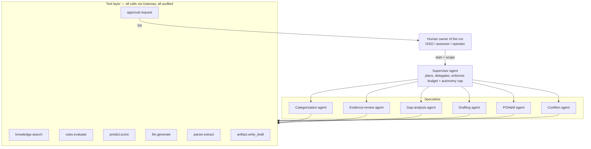

# 03 — Agents and Governance

> Status: **PROPOSED** (Gate G0)

## 1. Agent architecture

A **supervised multi-agent** design: one Supervisor plans and delegates;
specialist agents each have a narrow toolset. The **rules engine** is a tool,
not an agent — it is deterministic and is the authority on compliance facts.



## 2. Agent catalog (CanaPoint RMF)

| Agent | RMF step | Goal | Tools | Max autonomy | Needs approval for |
|---|---|---|---|---|---|
| Categorization | Categorize | Propose FIPS 199 impact levels from system description + data types | `knowledge.search`, `llm.generate`, `artifact.write_draft` | L2 | Any categorization becoming "proposed" (ISSO), final is G5 (AO) |
| Evidence-review | Assess | For each control, score whether linked evidence supports the requirement | `parser.extract`, `knowledge.search`, `rules.evaluate`, `llm.generate` | L3 | Publishing findings to the assessment record |
| Gap-analysis | Select / Implement | Compare implemented controls to baseline/overlay; list gaps with rationale | `rules.evaluate`, `knowledge.search`, `predict.score` | L3 | Publishing gap report |
| Drafting | Implement / Assess | Draft SSP narratives, SAR findings, executive summaries with citations | `knowledge.search`, `llm.generate`, `artifact.write_draft` | L2 | Every draft is reviewed before it leaves "draft" |
| POA&M | Authorize / Monitor | Draft POA&M items from findings; propose milestones; predict slippage | `predict.score`, `llm.generate`, `artifact.write_draft` | L4 | Creating/modifying POA&M records; **closing is G5** |
| ConMon | Monitor | Watch scans + evidence expiry; open draft actions; monthly ConMon summary | `predict.score`, `rules.evaluate`, `knowledge.search`, `approval.request` | L4 | Any notification sent outside Forge; any record change |
| Supervisor | All | Decompose goal, assign specialists, merge results, stop on budget/time | delegates only | = run cap | Plan approval when run cost estimate > threshold |

### Tool permission model

Each tool declares a **risk tier**; the run's autonomy cap decides what pauses.

| Tier | Examples | L1 | L2 | L3 | L4 |
|---|---|---|---|---|---|
| T0 read | `knowledge.search`, `rules.evaluate`, `predict.score`, `parser.extract` | auto | auto | auto | auto |
| T1 generate | `llm.generate` | auto | auto | auto | auto |
| T2 draft write | `artifact.write_draft` (draft space only) | ✗ | approve | auto | auto |
| T3 record write | update POA&M, attach finding to assessment | ✗ | ✗ | approve | approve* |
| T4 external | email/ticket/webhook outside platform | ✗ | ✗ | approve | approve |
| T5 reserved | conclusions, risk acceptance, ATO, close POA&M | **never** | **never** | **never** | **never** |

\* L4 may auto-execute T3 only for actions on an admin-maintained allowlist
(e.g. "set POA&M milestone date within ±14 days of proposal").

T5 actions **are not implemented as tools at all** — an agent physically
cannot call them. They exist only as human UI actions.

## 3. Gates G0–G5

| Gate | Trigger | Approver role | Evidence recorded | Blocks |
|---|---|---|---|---|
| **G0** Design | Any PR | Forge engineering lead | GitHub review + merge | Merge |
| **G1** Data | New source/dataset reaches `pending_approval` | `data-steward` (new role) | classification confirmed, scan result, hash | Ingestion / training use |
| **G2** Training | `training_jobs` created | `approver` | dataset ids, config hash, GPU-hour budget | Job start |
| **G3** Promotion | Version → `production` | two distinct `approver`s | eval + red-team report ids, both identities | Existing `promoteModel` in `worker/src/handlers/models.ts` + new eval precondition |
| **G4** Agent action | Tool call above auto tier | run owner or assigned role | proposed action, diff, agent rationale, sources | Workflow `waitForEvent` |
| **G5** Reserved | Human-only UI action | designated authority (AO, SCA, ISSO) | signer identity, statement, linked AI artifacts | n/a — never automated |

Every gate decision writes `audit_events` with event types:

```
data.source.approval_requested   data.source.approved   data.source.rejected
training.job.approval_requested  training.job.approved  training.job.rejected
model.promotion.eval_checked     (plus existing model.promotion.approval_recorded, model.promoted)
agent.run.started  agent.step.completed  agent.action.approval_requested
agent.action.approved  agent.action.rejected  agent.action.edited
agent.run.halted   agent.run.completed
decision.reserved.signed
```

These flow into the existing `/api/audit/export` bundle per `conmon_period`.

### Approval rules

- **Separation of duties**: the person who started a run, uploaded a dataset,
  or launched a training job cannot approve their own G1/G2/G4 request.
- **Timeouts**: unanswered G4 requests expire (default 72 h) → run halts safely;
  nothing is auto-approved on timeout.
- **Edit-then-approve**: approvers can modify a proposed draft; the original vs
  edited pair is stored (it becomes fine-tuning preference data, after G1).
- **Kill switch**: `admin` can halt (a) one run, (b) all runs for a tenant,
  (c) all agents platform-wide. Implemented as a `system_config` flag checked
  before every tool call. Halting is itself audited at `critical` severity.
- **Budgets**: each run has max steps, max tokens, max wall-clock, max GPU
  seconds. Exceeding any → pause + G4 request for an extension.

## 4. Approvals Inbox (dashboard UX)

One page, `Approvals`, filtered to requests the user can act on:

```
┌ Approvals Inbox ──────────────────────────────────────────────────────┐
│ [G4] Evidence-review · System X · "Publish 9 findings"   2h ago  HIGH │
│      Agent rationale ▸   Sources (14) ▸   Diff ▸                     │
│      [Approve] [Edit & approve] [Reject + reason]                     │
│ [G1] Dataset "FY26 SAR corpus" · cui · 412 files         1d ago       │
│ [G2] Training job forge-compliance-v2 · 18 GPU-h          1d ago       │
└───────────────────────────────────────────────────────────────────────┘
```

Each item shows: what will happen, why the agent proposes it, the evidence and
sources, the confidence and rules-engine verdict, and what is irreversible.

## 5. Roles (extends `worker/src/middleware/rbac.ts`)

| Role | IdP group | New permissions |
|---|---|---|
| `viewer` | — | `knowledge:read`, `agents:read`, `predict:read` |
| `operator` | `ml-operator` | + `knowledge:write`, `agents:run`, `datasets:write`, `training:write` |
| `approver` | `ml-approver` | + `training:approve`, `agents:approve` |
| `data-steward` | `data-steward` (new) | `datasets:approve`, `knowledge:approve` |
| `authority` | `rmf-authority` (new) | `decisions:sign` (G5 only) |
| `admin` | `admin` | all + `agents:halt`, `config:write` |
| `service` | service token | `inference:invoke`, `endpoints:health`, `knowledge:read` (scoped) |

## 6. Proposed D1 schema (draft)

> Draft for review only. Becomes `worker/migrations/0002_*.sql` in Phase 3a+.
> Follows `0001_initial.sql` conventions: `TEXT` ids, `tenant_id` default
> `'forge'`, ISO timestamps, JSON in `*_json` columns.

```sql
CREATE TABLE knowledge_collections (
  id TEXT PRIMARY KEY, tenant_id TEXT NOT NULL DEFAULT 'forge',
  name TEXT NOT NULL, classification TEXT NOT NULL,
  vector_backend TEXT NOT NULL,            -- 'vectorize' | 'qdrant'
  system_id TEXT, shared INTEGER NOT NULL DEFAULT 0,
  created_by TEXT NOT NULL, created_at TEXT NOT NULL DEFAULT (datetime('now')),
  UNIQUE(tenant_id, name)
);

CREATE TABLE knowledge_sources (
  id TEXT PRIMARY KEY, tenant_id TEXT NOT NULL DEFAULT 'forge',
  collection_id TEXT NOT NULL REFERENCES knowledge_collections(id),
  filename TEXT NOT NULL, mime_type TEXT, size_bytes INTEGER,
  sha256_hash TEXT NOT NULL, storage_uri TEXT NOT NULL,   -- r2:// or minio://
  classification TEXT NOT NULL, suggested_classification TEXT,
  status TEXT NOT NULL DEFAULT 'uploaded',  -- see state diagram in 02
  chunk_count INTEGER, retention_until TEXT,
  uploaded_by TEXT NOT NULL, approved_by TEXT,
  created_at TEXT NOT NULL DEFAULT (datetime('now')), updated_at TEXT NOT NULL DEFAULT (datetime('now'))
);

CREATE TABLE datasets (
  id TEXT PRIMARY KEY, tenant_id TEXT NOT NULL DEFAULT 'forge',
  name TEXT NOT NULL, purpose TEXT NOT NULL,  -- 'fine_tune' | 'predictive' | 'eval'
  classification TEXT NOT NULL, source_ids_json TEXT NOT NULL,
  record_count INTEGER, sha256_hash TEXT, storage_uri TEXT,
  status TEXT NOT NULL DEFAULT 'draft',       -- draft | pending_approval | approved | retired
  created_by TEXT NOT NULL, approved_by TEXT,
  created_at TEXT NOT NULL DEFAULT (datetime('now'))
);

CREATE TABLE training_jobs (
  id TEXT PRIMARY KEY, tenant_id TEXT NOT NULL DEFAULT 'forge',
  kind TEXT NOT NULL,                         -- 'qlora' | 'dpo' | 'lightgbm'
  base_model TEXT, dataset_ids_json TEXT NOT NULL, config_json TEXT NOT NULL,
  config_sha256 TEXT NOT NULL, gpu_hours_budget REAL,
  status TEXT NOT NULL DEFAULT 'pending_approval', -- pending_approval|queued|running|succeeded|failed|cancelled
  mlflow_run_id TEXT, output_model_version_id TEXT,
  requested_by TEXT NOT NULL, approved_by TEXT,
  created_at TEXT NOT NULL DEFAULT (datetime('now')), finished_at TEXT
);

CREATE TABLE eval_results (
  id TEXT PRIMARY KEY, model_version_id TEXT NOT NULL REFERENCES model_versions(id),
  suite TEXT NOT NULL,                        -- 'golden-rmf' | 'red-team' | 'regression'
  metrics_json TEXT NOT NULL, passed INTEGER NOT NULL,
  report_uri TEXT, created_at TEXT NOT NULL DEFAULT (datetime('now'))
);

CREATE TABLE agent_runs (
  id TEXT PRIMARY KEY, tenant_id TEXT NOT NULL DEFAULT 'forge',
  agent TEXT NOT NULL, goal TEXT NOT NULL, scope_json TEXT NOT NULL,
  autonomy_cap TEXT NOT NULL,                 -- 'L1'..'L4'
  budget_json TEXT NOT NULL, workflow_instance_id TEXT,
  status TEXT NOT NULL DEFAULT 'running',     -- running|awaiting_approval|halted|completed|failed
  started_by TEXT NOT NULL,
  created_at TEXT NOT NULL DEFAULT (datetime('now')), finished_at TEXT
);

CREATE TABLE agent_steps (
  id TEXT PRIMARY KEY, run_id TEXT NOT NULL REFERENCES agent_runs(id) ON DELETE CASCADE,
  seq INTEGER NOT NULL, agent TEXT NOT NULL, tool TEXT NOT NULL, risk_tier TEXT NOT NULL,
  input_summary TEXT, output_summary TEXT,    -- no restricted content; summaries/ids only
  source_ids_json TEXT, tokens INTEGER, latency_ms INTEGER, status TEXT NOT NULL,
  created_at TEXT NOT NULL DEFAULT (datetime('now')),
  UNIQUE(run_id, seq)
);

CREATE TABLE approval_requests (
  id TEXT PRIMARY KEY, tenant_id TEXT NOT NULL DEFAULT 'forge',
  gate TEXT NOT NULL,                         -- 'G1'|'G2'|'G4'
  resource_type TEXT NOT NULL, resource_id TEXT NOT NULL,
  requested_by TEXT NOT NULL, required_role TEXT NOT NULL,
  proposal_json TEXT NOT NULL, rationale TEXT,
  status TEXT NOT NULL DEFAULT 'pending',     -- pending|approved|rejected|edited|expired
  decided_by TEXT, decision_note TEXT, edited_json TEXT,
  expires_at TEXT NOT NULL,
  created_at TEXT NOT NULL DEFAULT (datetime('now')), decided_at TEXT
);

CREATE TABLE predictions (
  id TEXT PRIMARY KEY, tenant_id TEXT NOT NULL DEFAULT 'forge',
  model_version_id TEXT NOT NULL, target TEXT NOT NULL,
  subject_type TEXT NOT NULL, subject_id TEXT NOT NULL,  -- e.g. 'control', 'AC-2@system-x'
  score REAL NOT NULL, explanation_json TEXT NOT NULL,   -- top SHAP contributions
  created_at TEXT NOT NULL DEFAULT (datetime('now'))
);

CREATE TABLE reserved_decisions (
  id TEXT PRIMARY KEY, tenant_id TEXT NOT NULL DEFAULT 'forge',
  decision_type TEXT NOT NULL,                -- 'assessment_conclusion'|'risk_acceptance'|'authorization'|'poam_close'
  subject_id TEXT NOT NULL, statement TEXT NOT NULL,
  signed_by TEXT NOT NULL, ai_artifact_ids_json TEXT,
  created_at TEXT NOT NULL DEFAULT (datetime('now'))
);
```

Indexes follow the existing `idx_<table>_<purpose>` pattern on
`(tenant_id, status, created_at DESC)`.

## 7. AI accountability record

For every AI-produced artifact the platform can answer, from D1 + audit alone:
which model version (and its eval report), which prompt template version,
which sources were retrieved, which agent and run, who approved it, and what
they changed. That is the "AI bill of materials" for a finding or narrative.
