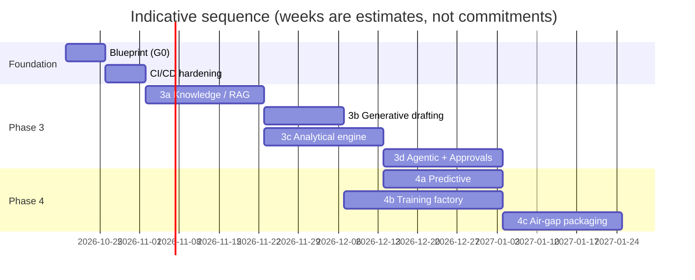

# 05 — Roadmap and Build Plan

> Status: **PROPOSED** (Gate G0)

Each phase is **one plan + one PR** (or a small stack). Claude drafts the plan
in the web UI, a Forge human approves it, Claude implements and drives CI
green, and the human merges. A phase is done only when its acceptance
criteria pass in staging and the human gate is signed off.

## Phase overview

| Phase | Name | Engines | Depends on | Human gate to close |
|---|---|---|---|---|
| 0 | **Blueprint** (this PR) | — | — | G0: blueprint approved |
| 0.5 | CI/CD hardening | — | 0 | G0 |
| 3a | Knowledge / RAG + data intake | Knowledge, Multimodal (parse) | 0.5 | G0 + first G1 approvals exercised |
| 3b | Generative drafting | Generative | 3a | G0 + assessor review of 20 drafts |
| 3c | Analytical engine | Analytical | 3a | G0 + rules-vs-assessor agreement report |
| 3d | Agentic orchestrator + Approvals Inbox | Agentic | 3b, 3c | G0 + G4 flow demo |
| 4a | Predictive | Predictive | 3c (labels) | G0 + G3 for first predictor |
| 4b | Training factory + eval + red-team | Learning | 3a, 3b | G0 + G2/G3 for first fine-tuned version |
| 4c | Air-gap packaging + signer hardening | all | 3a–4b | G0 + offline install demo |

---

## Phase 0.5 — CI/CD hardening (existing README TODO)

Scope:
- GitHub Actions for worker (typecheck, `node --test`), dashboard (typecheck,
  build), semgrep SAST, `npm audit`/dependency review, `wrangler deploy --dry-run`.
- zod schemas for request bodies.
- **D1 → Postgres** ([ADR-0007](../adr/0007-postgres-via-hyperdrive.md)):
  provision managed US-region Postgres (prod + staging), Hyperdrive configs,
  a `Db` interface replacing direct `env.DB.prepare` calls, port
  `0001_initial.sql`, migration runner, data copy from the pilot D1, then
  retire the D1 binding. This also clears the D1 account-cap blocker.
- Tenant-prefixed IdP groups (`forge-admin`, `forge-ml-operator`,
  `forge-ml-approver`) with backward-compatible parsing in `rbac.ts`.

Acceptance: every PR shows green checks; a deliberately failing test blocks
merge; staging and production run on separate Postgres databases; all 11
README smoke tests pass against Postgres; audit row counts match D1 after copy.

## Phase 3a — Knowledge / RAG + data intake

Scope:
- `0002_knowledge.sql`: `knowledge_collections`, `knowledge_sources`, `approval_requests`.
- `DATA_BUCKET` R2 binding (quarantine prefix); `VECTORIZE` binding.
- On-prem: `embedder`, `qdrant`, `parser`, `minio` services in `docker-compose.yml`; tunnel ingress entries.
- Gateway: `/api/knowledge/collections`, `/sources` (upload), `/search`, `/answer`; `/api/approvals` (G1 only).
- `ObjectStore` / `VectorStore` interfaces with Cloudflare + on-prem implementations.
- Dashboard: Knowledge page, upload wizard with classification, Approvals Inbox (G1).
- Seed collection: NIST 800-53 Rev 5 OSCAL catalog + 800-53A.

Acceptance:
- Upload a PDF as `internal` → G1 approve → searchable in < 5 min, answers cite pages.
- Upload as `cui` → bytes never appear in R2 (verified by listing), vectors in Qdrant only.
- Tenant A cannot retrieve tenant B chunks (automated test).
- Uploader cannot approve their own G1 request.
- Purge removes object + vectors; tombstone + audit event exist.

## Phase 3b — Generative drafting

Scope: versioned prompt templates (`prompts/`), `/api/generate/{ssp-narrative,sar-finding,poam-item,exec-summary}`, citation checker, draft workspace, original-vs-edited capture.

Acceptance: 20 AC/AU/IA narratives drafted for a sample system; assessor rubric ≥ "usable with minor edits" on ≥ 80%; 0 fabricated control IDs; every claim cited.

## Phase 3c — Analytical engine

Scope: `rules` service (OSCAL catalog + profile resolution, deterministic checks for evidence presence, freshness, parameter values, scan thresholds); LLM evidence assessor returning `{supports | partially | does_not | insufficient}` + rationale; disagreement surfacing (rules vs LLM); gap report.

Acceptance: on a labeled set of 200 control/evidence pairs, rules + assessor agreement with human assessors ≥ 85%, and rules engine never overridden by LLM on deterministic checks.

## Phase 3d — Agentic orchestrator + Approvals Inbox

Scope: Cloudflare Workflows binding + Durable Object for run state/streaming; Supervisor + Evidence-review + Gap-analysis + Drafting agents; tool registry with risk tiers; autonomy caps; budgets; kill switch; full G4 inbox; `agent_runs`, `agent_steps` tables; new roles in `rbac.ts`.

Acceptance: "Assess AC family for System X" runs end-to-end, pauses for G4 before publishing findings, resumes on approval, halts on reject/timeout; kill switch stops a running run within one step; T5 actions unreachable from any agent (test).

## Phase 4a — Predictive

Scope: feature pipeline from Postgres + scan/POA&M history; LightGBM control-failure-risk and evidence-expiry models; MLflow registration; `scorer` service; `/api/predict/*`; SHAP explanations; `predictions` table; drift job.

Acceptance: held-out AUC ≥ 0.75 for control-failure risk (or documented baseline if data is thin); calibration error < 0.1; every prediction shows top-5 drivers; promotion through G3.

## Phase 4b — Training factory + eval + red-team

Scope: `trainer` service (GPU profile), `datasets`, `training_jobs`, `eval_results` tables; G2 flow; QLoRA + DPO from edit pairs; golden RMF eval suite; garak/promptfoo red-team; G3 precondition = passing `eval_results`; model card generator.

Acceptance: `forge-compliance-v2` trained from approved data, beats v1 on golden set without regression, passes red-team with 0 critical, promoted via two approvers; rollback to v1 verified.

## Phase 4c — Air-gap packaging + signing

Scope: `workerd`-based local control plane, on-prem Postgres/MinIO/Qdrant/Keycloak adapters, local workflow runner, offline signed bundle build + verifier; asymmetric audit signing replacing the HMAC placeholder.

Acceptance: fresh, network-isolated host installs from bundle and passes the existing 11-step smoke test plus Phase 3a–4b acceptance tests, with no outbound connections (verified by firewall logs).

---

## Hardware sizing and hosting (GPU host)

| Tier | Use | Suggested spec |
|---|---|---|
| **Pilot** | 8B models serving + embeddings + QLoRA on 8B | 1× 48 GB GPU (L40S / RTX 6000 Ada), 32 vCPU, 256 GB RAM, 4 TB NVMe |
| **Production** | 70B (4-bit) serving or several 8–32B models; QLoRA on 32B | 2–4× 80 GB (H100/H200 or A100), 64 vCPU, 512 GB RAM, 8 TB NVMe |
| **Air-gap customer** | Same as pilot or production, plus a transfer workstation | per customer |

Training can share the serving host in pilot (scheduled off-hours); split to a
dedicated trainer node at production.

**Decided: pilot box = Hetzner GEX130** (1× RTX 6000 Ada 48 GB, Xeon Gold
5412U, 128 GB RAM — upgrade RAM if available) — see
[ADR-0008](../adr/0008-pilot-gpu-hosting-hetzner.md). Hetzner GEX131 (96 GB
Blackwell) is the step-up option. Constraint: Hetzner GPU servers are in
Germany / Finland with no FedRAMP authorization or HIPAA BAA, so the pilot
host is limited to **`public` / `internal` / synthetic data**. CUI, PHI and
classified workloads run only on customer premises or a US FedRAMP / GovCloud
GPU host, enforced by a per-endpoint `allowed_classifications` setting.

## Cloudflare products used (and alternatives)

| Need | Cloudflare (default) | Alternative if needed |
|---|---|---|
| API / gateway | Workers | — |
| Metadata | **Postgres via Hyperdrive** (managed, US region, e.g. Neon or AWS RDS) — decided, replaces D1 | Postgres on-prem (air-gap) |
| Objects | R2 | — |
| Vectors (non-restricted) | Vectorize | Qdrant everywhere |
| Orchestration | Workflows + Durable Objects | Temporal on-prem (air-gap) |
| Queues | Queues | — |
| Identity | Access | Keycloak (air-gap) |
| Inference | **on-prem** (Workers AI only for `public` demos, opt-in) | — |

## Reviewer decisions (recorded 2026-10-17)

| # | Item | Decision |
|---|---|---|
| 1 | Roles | Data steward split into `data-steward` / `data-steward-restricted`; RMF authority split into NIST 800-37 `rmf-isso`, `rmf-sca`, `rmf-ao`. IdP group = eligibility, per-system assignment = authority. Groups tenant-prefixed (`<tenant>-…`). See [`03` §5](03-agents-and-governance.md#5-roles-extends-workersrcmiddlewarerbacts). |
| 2 | Default autonomy cap | **L2 (Copilot)** for new tenants. |
| 3 | Retention | Best-practice defaults in [`02` §6](02-data-and-learning.md#6-retention-decided-best-practice-defaults). |
| 4 | Pilot GPU | Single 48 GB box on Hetzner (GEX130), public/internal/synthetic data only ([ADR-0008](../adr/0008-pilot-gpu-hosting-hetzner.md)). |
| 5 | Metadata DB | Move from D1 to managed US-region Postgres via Hyperdrive in Phase 0.5 ([ADR-0007](../adr/0007-postgres-via-hyperdrive.md)); resolves the D1 account cap. |

### Still open
- Pick the managed Postgres provider (Neon vs AWS RDS) at Phase 0.5 planning.
- Confirm current Hetzner GEX130 price/availability before ordering.
